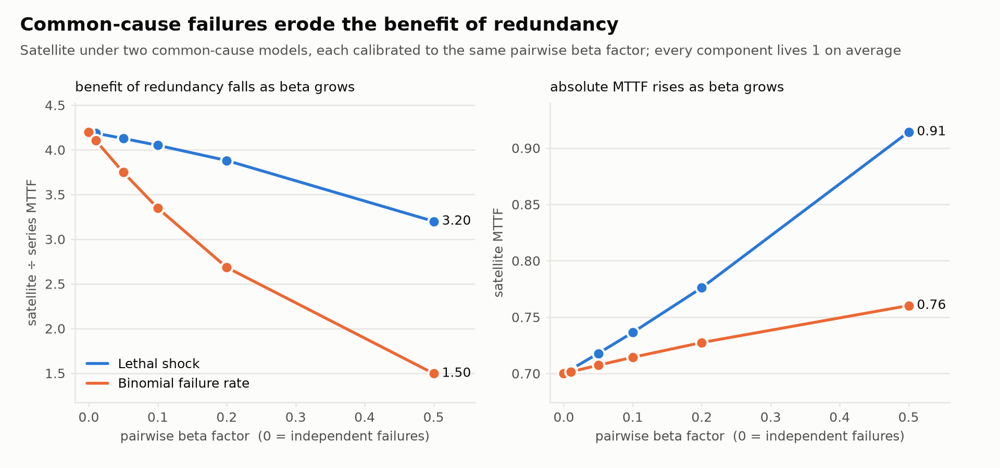
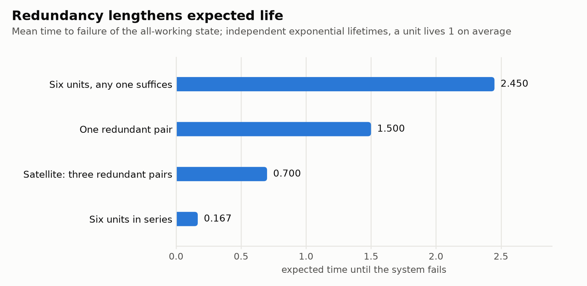
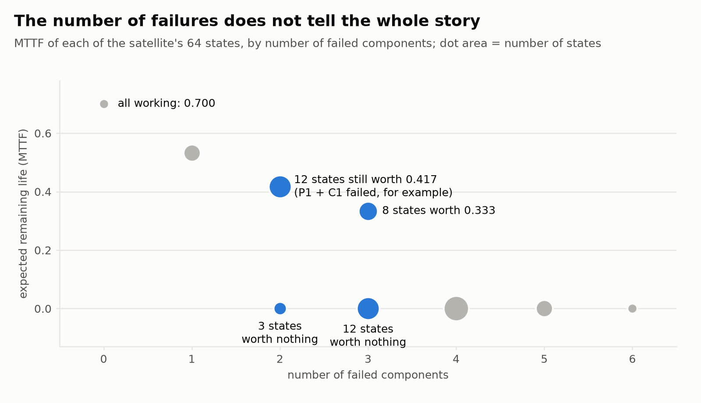
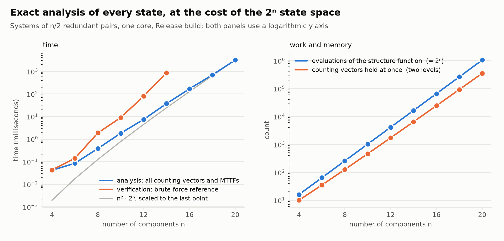
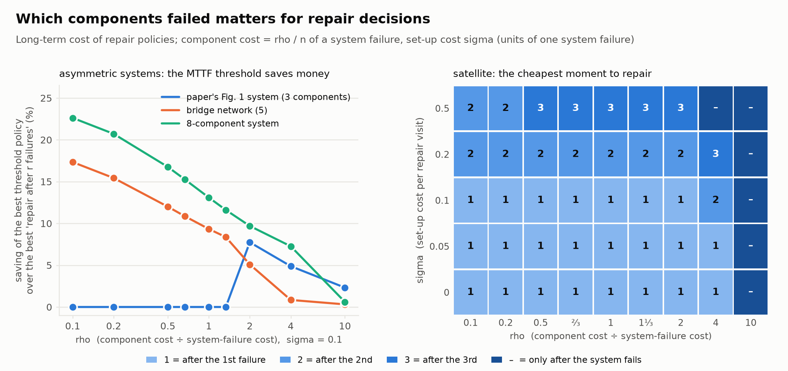
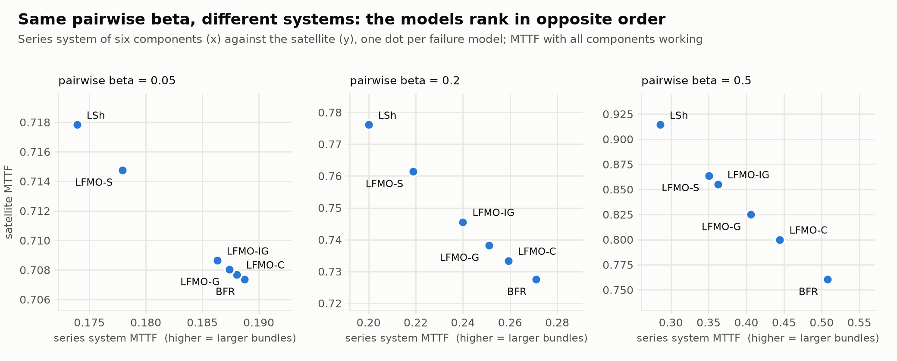
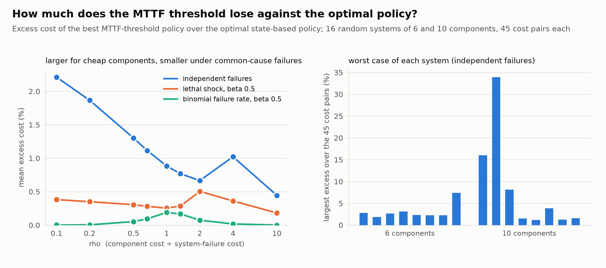
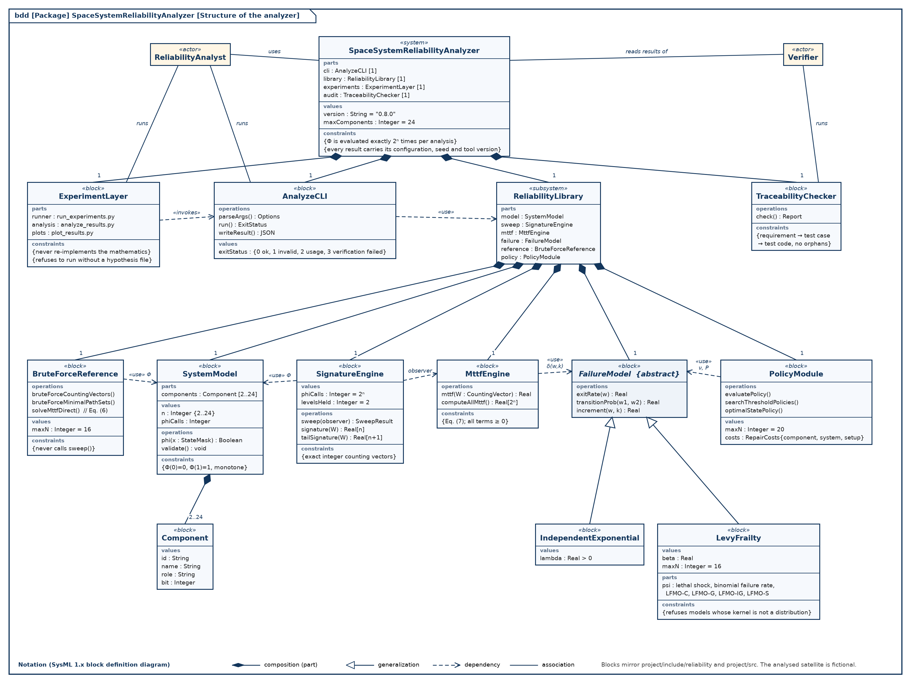

<div align="center">

# Space System Reliability Analyzer

**How long does a system keep working when its parts fail, and what if one event can break several parts at once?**

[](https://github.com/giba12/Systems-With-Simultaneous-Failures/actions/workflows/ci.yml)


[Quick start](#quick-start) ·
[What you will see](#what-you-will-see) ·
[Findings](#key-findings) ·
[Use it on your own system](#analyse-your-own-system) ·
[Documentation](#documentation) ·
[Limits](#limits-and-honest-status)

<br>



</div>

---

## In plain words

Imagine a satellite whose power, radio and computer each exist twice. It keeps working as long as **one of each pair**
survives. On average, how long will it last? And what if a single event (a solar storm, say) can knock out several
parts together?

This project answers that **exactly**, for every possible combination of working and broken parts, using the algorithm
of Lagos & Ávila,
[*Per-State Signatures and Mean Time-to-Failure: An Algorithm for Systems With Simultaneous Failures*](https://arxiv.org/abs/2610.22181)
(arXiv:2610.22181). It also:

* **checks itself**: every answer is compared with an independent brute-force calculation, a second equation, closed-form
  formulas and the paper's own worked example;
* **compares repair policies**: when is it worth replacing failed parts?
* **tests its own predictions**: seven experiments whose hypotheses were written down *before* they were run, with the
  wrong predictions reported rather than hidden.

> **Educational portfolio project.** The satellite is **fictional**. This is not a certified safety analysis, not
> flight-qualified, and not a statement about any real spacecraft or organisation's tools.

---

## Quick start

You need three things: a C++ compiler, CMake (3.20 or newer) and Python 3. Everything else is downloaded automatically
the first time. Total time: about 5 minutes the first time, then seconds.

### 1. Install the tools (once)

| Your computer | Run this in a terminal |
|---|---|
| **Ubuntu / Debian / Windows with WSL** | `sudo apt update && sudo apt install -y build-essential cmake python3 python3-venv git` |
| **macOS** | `xcode-select --install` and then `brew install cmake` ([Homebrew](https://brew.sh)) |
| **Windows** | Install [WSL](https://learn.microsoft.com/windows/wsl/install) (Ubuntu), then follow the Ubuntu row inside it |

### 2. Get the code

```bash
git clone https://github.com/giba12/Systems-With-Simultaneous-Failures.git
cd Systems-With-Simultaneous-Failures/project
```

### 3. Pick one

| I want to… | Run | Takes |
|---|---|---|
| **See what it does** (a guided tour) | `./demo.sh` | under a minute, plus a one-off build |
| **Do everything**: build, test, analyse, run all seven experiments, draw the figures | `./run_all.sh` | about 3–6 minutes |

```bash
./demo.sh
```

If something is missing the scripts say so in plain words (for example *"'cmake' is required but not installed"*).
Everything they create is either in `project/build/` or `project/results/`, both ignored by git, so deleting those
folders puts you back to a clean start.

---

## What you will see

These are real, captured outputs, not mock-ups. Full copies are in [docs/sample-output/](docs/sample-output/).

### The guided tour (`./demo.sh`)

```text
=== 1. The system: three redundant pairs (power, communications, computers); all three pairs must survive ===
  expected lifetime of the new system (a component lives 1 on average): 0.7
  working states out of 64: 27
  independent verification (brute force + a second equation): PASSED
  structure function evaluated 64 times = 2^6, once per state

=== 2. Same number of failures, very different futures ===
  power unit A and communications unit A failed : expected remaining life 0.4167
  power unit A and power unit B failed          : expected remaining life 0.0000   (a whole pair is gone)

=== 3. Common-cause failures (one event can fail several parts at once) ===
  model                              satellite MTTF     six in series      benefit of redundancy
  independent failures               0.7000             0.1667             x4.20
  lethal shock, beta=0.2             0.7761             0.2000             x3.88
  lethal shock, beta=0.5             0.9143             0.2857             x3.20
  binomial failure rate, beta=0.5    0.7603             0.5079             x1.50

=== 4. The price of exactness: 20 components = 1,048,576 states, every one analysed ===
  analysis time: 1.53 s, peak memory: 34.7 MB
```

How to read it: the satellite lives **0.7** time units on average (a single part lives 1). Losing two parts can leave
**0.42** units to go, or **zero** if both were partners in the same pair; *which* parts fail matters, not just how many.
Common-cause failures make redundancy worth less: its advantage shrinks from 4.2× to 1.5×. The full output is in
[docs/sample-output/demo.txt](docs/sample-output/demo.txt).

### Tests and self-checks (`./run_all.sh`)

```text
100% tests passed, 0 tests failed out of 129

  satellite_exp                      MTTF of the new system 0.7000   verification PASSED
  satellite_lethal_shock             MTTF of the new system 0.9143   verification PASSED
  satellite_binomial_failure_rate    MTTF of the new system 0.7603   verification PASSED
```

### Experiment verdicts (predictions made in advance, judged afterwards)

```text
exp1: 15/15 predictions supported
exp2: 6/8 predictions supported; REJECTED: BFR hurts redundancy less than lethal shock, beta = 0.01 is near the independent baseline
exp3: 9/9 predictions supported
exp4: 7/8 predictions supported; REJECTED: verification vs analysis at n = 14
exp5: 8/8 predictions supported
exp6: 6/7 predictions supported; REJECTED: 5: series and satellite rank the models identically
exp7: 7/7 predictions supported
```

A **REJECTED** line is a result, not a failure: the prediction turned out to be wrong, and the
[experiment report](docs/experiment-report.md) says so and why.

### How exactness scales (Experiment 4)

```text
  n = 12: analysis       4.12 ms, peak memory      4.3 MB
  n = 16: analysis      77.71 ms, peak memory      5.9 MB
  n = 20: analysis    1323.33 ms, peak memory     34.7 MB      (1,048,576 states, all analysed exactly)
```

### The raw result of one analysis

`build/analyze --config configs/satellite_support.json --verify` prints JSON; an extract:

```json
"results": {
  "mttf_all_working": 0.7,
  "operational_states": 27,
  "system_signature": [0.0, 0.2, 0.4, 0.4, 0.0, 0.0],
  "phi_calls": 64
},
"verification": { "passed": true }
```

The full file is [docs/sample-output/analyze-satellite.json](docs/sample-output/analyze-satellite.json). Reading
`system_signature`: the chance the system dies at the *k*-th component failure is 0%, 20%, 40%, 40%, 0%, 0% for
k = 1…6.

---

## Key findings

| | |
|---|---|
| Satellite (three redundant pairs), MTTF of the new system | **0.700** (six in series: 0.167; one pair: 1.5) |
| Two failures, different units | MTTF **0.417** if the failed units are in different pairs, **0** if they are partners |
| Common cause (β = 0.5), benefit of redundancy | 4.20 → **3.20** (lethal shock), **1.50** (binomial failure rate) |
| 20 components, 1,048,576 states | analysed exactly in a few seconds and 35 MB |
| Repair policies (small asymmetric systems) | the MTTF-threshold policy saves up to 8.8 – 23.5 % over "repair after r failures"; on the symmetric satellite the two coincide |
| Pre-registered predictions | **58 of 62 supported** in the latest full run (57 in the first); **4 rejections are stable** (two in Experiment 2, one each in Experiments 4 and 6), plus one prediction that depends on timing. All reported as found |

### Figures

All seven figures are regenerated by `./run_all.sh` into `project/results/figures/`. The committed copies are in
[docs/figures/](docs/figures/).

| | |
|---|---|
|  |  |
| **Fig. 1.** Redundancy lengthens expected life | **Fig. 2.** Common-cause failures erode its benefit |
|  |  |
| **Fig. 3.** Equal failure counts, very different futures | **Fig. 4.** Exact analysis up to a million states |

<details>
<summary>Three more figures (repair policies, six models, distance to optimal)</summary>

| | |
|---|---|
|  |  |
| **Fig. 5.** Repair policies compared | **Fig. 6.** Six common-cause models |



**Fig. 7.** How far simple repair rules are from the optimal policy

</details>

---

## Analyse your own system

A system is a small JSON file: list the parts and say how they combine. This is the satellite
([`project/configs/satellite_support.json`](project/configs/satellite_support.json)):

```json
{
  "name": "satellite_support",
  "components": [
    { "id": "P1", "name": "Power unit A", "bit": 0 },  { "id": "P2", "name": "Power unit B", "bit": 1 },
    { "id": "C1", "name": "Communications unit A", "bit": 2 },  { "id": "C2", "name": "Communications unit B", "bit": 3 },
    { "id": "K1", "name": "Computer A", "bit": 4 },  { "id": "K2", "name": "Computer B", "bit": 5 }
  ],
  "structure": { "type": "and_of_or_groups", "groups": [["P1", "P2"], ["C1", "C2"], ["K1", "K2"]] }
}
```

Copy it, edit it, and run (from the `project/` folder after a build):

```bash
build/analyze --config my_system.json --verify                       # independent failures, with self-check
build/analyze --config my_system.json --model lsh --beta 0.5         # lethal-shock common cause
build/analyze --config my_system.json --model bfr --beta 0.5         # binomial-failure-rate common cause
build/analyze --config my_system.json --per-state --out result.json # every one of the 2^n states, saved to a file
build/analyze --config my_system.json --c-comp 0.1 --c-sys 1 --c-set 0.05   # also compare repair policies
build/analyze --help                                                 # every option
```

Exit codes: `0` success, `1` invalid input, `2` usage error, `3` verification failed.

---

## Documentation

| If you want… | Read |
|---|---|
| the whole story in one document | [docs/technical-report.md](docs/technical-report.md) |
| a guided run, explained | [docs/demo.md](docs/demo.md) |
| the results and the rejected predictions | [docs/experiment-report.md](docs/experiment-report.md) |
| how it was verified, and what was **not** | [docs/verification-report.md](docs/verification-report.md) |
| every deviation from the paper | [docs/deviation-log.md](docs/deviation-log.md) |
| the paper's symbols in plain language | [docs/notation-glossary.md](docs/notation-glossary.md) |
| the code, module by module | [project/README.md](project/README.md) |
| the full index (requirements, test plan, design, diagrams) | [docs/README.md](docs/README.md) |

<details>
<summary>Architecture diagram (SysML)</summary>



More diagrams (use case, sequence, component, object) are listed in [docs/README.md](docs/README.md).

</details>

---

## Repository layout

```text
.
├── project/                 the software
│   ├── include/ , src/      C++20 library and the `analyze` command-line tool
│   ├── tests/               129 automated tests (C++ unit tests, Python end-to-end tests, traceability check)
│   ├── python/              experiment runner, result tables, figures
│   ├── experiments/         the hypotheses, written before the experiments were run
│   ├── configs/             example systems (the fictional satellite)
│   ├── demo.sh              guided tour
│   └── run_all.sh           build + test + analyse + experiments + figures
├── docs/                    reports, requirements, test plan, design, diagrams, figures, sample output
└── .github/workflows/       continuous integration (g++, clang++, and an ASan/UBSan sanitizer job)
```

---

## Limits and honest status

* **Tested on** Linux (WSL2) with g++ 13.3 and clang++ 18.1: no compiler warnings, 129/129 tests, sanitizer-clean.
  GitHub Actions runs the same build, tests and sanitizer jobs on every push (see the badge at the top).
* **Size limits.** The common-cause models handle up to 16 components (numerical precision) and repair policies up to
  20. Plain independent-failure analysis goes further (the documents record 24).
* **Repair-policy experiments** use small systems (3 to 10 components). Components are assumed identical, as in the paper.
* The complete list of deviations and limits is in the [deviation log](docs/deviation-log.md).

## Licence and credits

No licence has been chosen yet; until one is added, all rights are reserved by default.

The algorithm and the models are the work of Lagos & Ávila (arXiv:2610.22181). The paper is **not** included in this
repository; the documents refer to a local copy named `docs/paper3.pdf` (ignored by git) and to a project guide
`docs/space_system_reliability_analyzer_project_guide.docx` (also not published).
