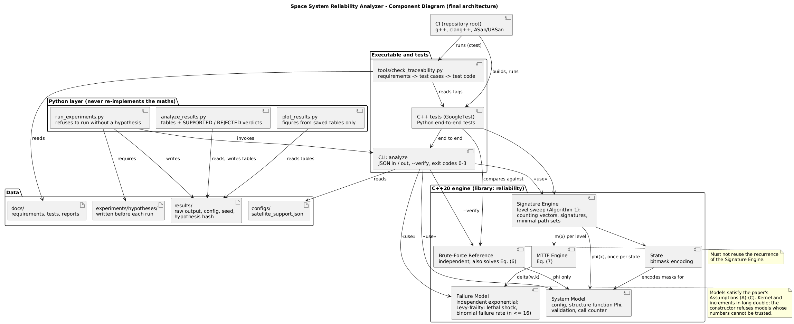
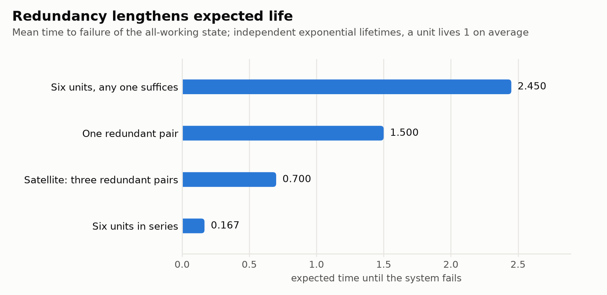
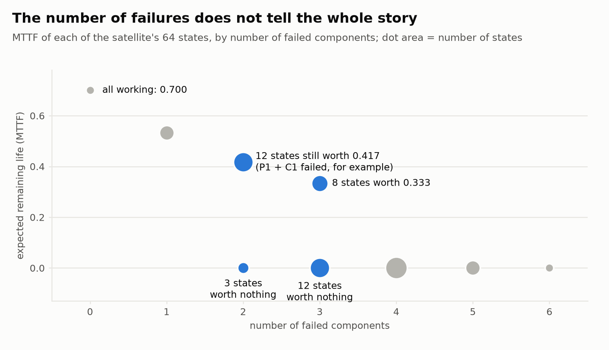
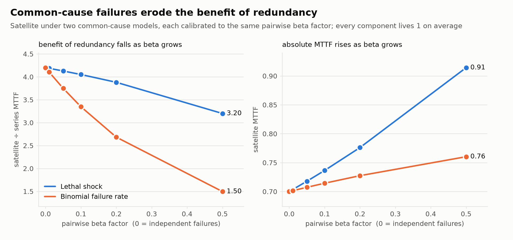
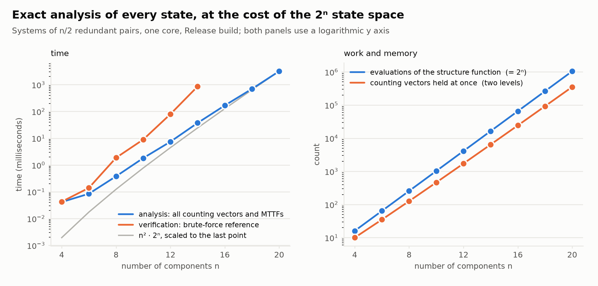
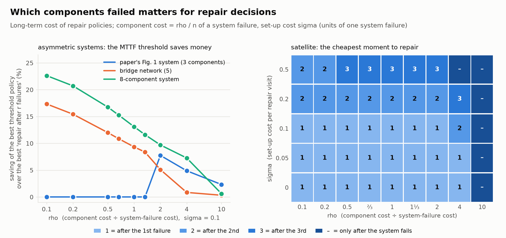
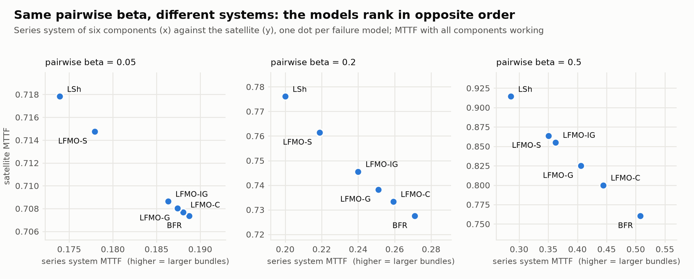
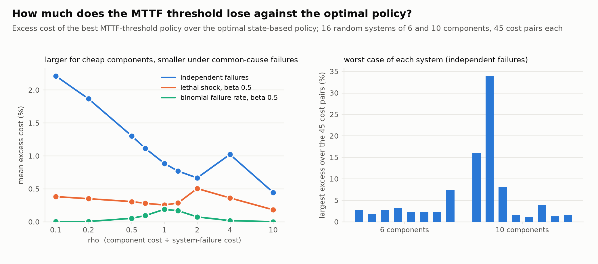

# Per-State Reliability Analysis of a Fictional Satellite-Support System

**Technical report** · Space System Reliability Analyzer · 2026-10-22

> **Scope.** This is an educational portfolio project. The satellite-support system is **fictional**. Nothing here is a
> certified safety analysis, a flight-qualified model, or a statement about any real spacecraft or any organisation's tools.

## Summary

Reliability numbers are almost always quoted for a system with every component working. Maintenance decisions, however,
are taken at *partially failed* states: someone sees which components have died and must decide whether to carry on.
This project implements the algorithm of Lagos and Ávila (arXiv:2610.22181), which computes a system's **signature**
and **mean time to failure (MTTF) at every one of its 2ⁿ states** for the cost of evaluating the system's structure
function once per state, including when a single event can fail several components at once. It applies the algorithm
to a six-component fictional satellite architecture, verifies it against an independent implementation and against
closed-form results, runs seven pre-registered experiments, and reports what held and what did not. Of the 62
checks derived from the predictions written before the experiments, **57 were supported and 5 rejected in the first run
(for Experiments 1–4, 45 and 3 in an independent repeat of those experiments)**; the rejections are reported as found. A final, optional part
implements the paper's repair-policy cost model and compares repair strategies. Along
the way the work found a typo in the paper's Eq. (21) and corrected it.

## 1. The engineering question

*Given which components of a redundant system have failed, how much useful life is left — and how does the answer change
when failures are not independent?*

Two states with the same number of failed components can differ sharply in remaining life, depending on **which**
components failed. A rule that looks only at the failure count discards that information. Acting on it requires the
reliability index at all states, not only at the all-working one, which at first looks like 2ⁿ separate computations.

## 2. The system

Six components in three redundant pairs; the system works while **every pair has at least one working unit**:

| Pair | Components | Role |
|---|---|---|
| Power | P1, P2 | primary and redundant power source |
| Communications | C1, C2 | primary and backup communications |
| Computers | K1, K2 | primary and backup processing |

Φ(x) = (P1 ∨ P2) ∧ (C1 ∨ C2) ∧ (K1 ∨ K2). A **state** is a six-bit number whose bit *i* is 1 if component *i* works, so
there are 2⁶ = 64 states; state 63 (`111111`) is "everything works" and 62 (`111110`) is "power unit A has failed".
27 of the 64 states are operational. The model is deliberately small so that every number can be checked by hand.

## 3. The method

**Counting vector.** For a state x with |x| working components, W[k] counts the ways to switch off exactly k more
working components and still have a working system. For the fully working satellite, W = [1, 6, 12, 8, 0, 0, 0]: one way
to remove nothing, six single failures, twelve pairs (15 minus the 3 that empty a pair), eight triples (one from each
pair), none beyond.

**The recursion that avoids recounting** (paper, Lemma 1): W[k] of a state is the average of W[k−1] over its "sons" (the
state with one more component failed), divided by k, because each case is seen by exactly k sons. The sweep therefore
goes level by level from "all failed" to "all working", asks the structure function once per state, and keeps only two
levels in memory.

**Signature and MTTF.** The tail signature S̄[k] = W[k]/C(|x|,k) is the fraction of k-failure cases that still work; the
signature s[k] = S̄[k−1] − S̄[k] is the probability the system fails exactly at the k-th component failure (for the
satellite: 0, 0.2, 0.4, 0.4, 0, 0). Given how long the k-th failure takes to arrive, the MTTF follows (Eq. (7)):

  m(x) = Σₖ [ W[k] / C(|x|,k) ] · ( E T_{k+1:|x|} − E T_{k:|x|} ).

**Failure models** supply those expected waiting times. Independent exponential lifetimes give 1/(λ(w−k)). Simultaneous
failures use the paper's Lévy-frailty family, calibrated so every component lives 1 time unit on average and
parameterised by the **pairwise beta factor** β: the *lethal shock* (one event kills every working component) and the
*binomial failure rate* (a shock fails each working component with probability β). All three satisfy the paper's
assumptions: exchangeable components whose survivor count is a continuous-time Markov chain.

**Worked example, state 62** (P1 failed): W = [1, 4, 4, 0, 0, 0], tail signature (1, 0.8, 0.4, 0, 0, 0), signature
(0.2, 0.4, 0.4, 0, 0), and with independent exponential lifetimes m = 1/5 + (4/5)/4 + (4/10)/3 = 8/15 ≈ 0.533, against
0.7 for the fully working satellite.

## 4. Implementation and architecture

A C++20 library (`state`, `system_model`, `signature`, `failure_model`, `mttf`, and an independent `reference`), a
command-line tool `analyze` (JSON in and out), and a Python layer that only calls that tool. The other diagrams are in
[uml/](uml/) (use case, sequence, object). Design decisions that matter:

* **Exact integers.** Counting vectors are integers; each signature entry comes from an exact integer numerator and is
  rounded once.
* **Φ once per state**, two levels in memory: at 20 components the sweep holds 352 716 vectors at once instead of 1 048 576.
* **An independent reference** that never uses the recurrence, plus a direct solution of the MTTF equations, wired into
  `analyze --verify`.
* **Precision where it is needed.** The simultaneous-failure formulas are alternating sums; they are computed in
  `long double`, refused when the numbers cannot be trusted, and capped at 16 components.
* **Nothing hidden.** Invalid input fails with a message naming the problem and a distinct exit code.

## 5. Results that reproduce the paper

| Claim | Finding |
|---|---|
| The paper's Fig. 1 example (3 components) | counting vectors, signature (0, 2/3, 1/3), MTTF 7/6 and the 86 % / 43 % ratios reproduce exactly and are covered by tests |
| Fig. 1's repair-policy costs 97/105, 11/15, 1/10 (Eqs. (9)–(13)) | reproduced by the delivered policy code (tested), which also agrees with the paper's independent Proposition 3 on more than 300 policies under three failure models |
| The cost curve over the threshold γ is not unimodal | reproduced with a concrete 8-component example; a search that stops at the first rise misses the optimum |
| Algorithm 1 evaluates Φ exactly 2ⁿ times and holds two levels (Theorem 2) | confirmed for n = 4…20; peak vectors equal the largest sum of two adjacent binomial coefficients |
| MTTF never rises when more components fail (Lemma 4) | holds on > 40 000 state pairs under four failure models |
| Signature dominance implies MTTF order (Theorem 5) | holds, strictly, on thousands of pairs; its **converse is false** (a six-component counterexample: MTTF 1.0 against 0.75 although the signatures cross) |
| No assumption on Φ is needed | the sweep matches brute force on 60 random, non-monotone Boolean functions |
| **Eq. (21)** | the printed lower summation limit w−k+1 is a typo (it gives 0 at k = 0); the correct limit is w−k |

## 6. New experiments

Hypotheses were committed before the runner existed; every prediction was then tested against the data. Full details,
tables and caveats are in the [experiment report](experiment-report.md).

| Experiment | Question | Predictions supported |
|---|---|---|
| 1 Redundancy vs reliability | what does redundancy buy? | 15 / 15 |
| 2 Independent vs simultaneous failures | how does common cause change the benefit of redundancy? | 6 / 8 |
| 3 Equal failure counts | can equal counts hide very different states? | 9 / 9 |
| 4 Scaling | how do time and memory grow with n? | 6 / 8 |
| 5 Repair policies | when to repair, and does the MTTF threshold beat "repair after r failures"? | 8 / 8 |

The satellite lives 0.70 time units, four times longer than six units in series (0.167) but less than one redundant
pair (1.5), because all three pairs must survive.

With two failures the satellite is still worth 0.417 if the dead units are in different pairs and nothing if they are
partners. This is the paper's motivating observation, measured.

Under both common-cause models the satellite's absolute MTTF *rises* with β (failures bunch together) while the benefit
of redundancy relative to a series system *falls*: 4.20 → 3.20 (lethal shock) and → 1.50 (binomial failure rate) at
β = 0.5. **Two predictions were rejected here.** I had predicted the binomial model would hurt redundancy *less* than the
lethal shock; it hurts it more. A follow-up check (not pre-registered) fits one explanation: a single pair behaves
identically under both models, and they diverge as pairs are added.

Analysis time grows ×4.2 to ×5.0 per two components (consistent with O(n²·2ⁿ)); 20 components (a million states) take
3.2 s and 35 MB. **Further predictions were rejected**: verification being at least 100× slower than the analysis at n = 14 (it is 18–23×, in both runs), and, in the first
run only, a verification-time growth criterion (timing noise at small n; supported on the repeat).

### Repair policies

When is a repair worth it? With cheap components and no set-up cost, repair at the first failure; as set-up costs grow,
tolerate more failures and group the replacements; with expensive components, repair only after the system fails.
On the symmetric satellite the paper's MTTF-threshold policy is exactly the "repair after r failures" rule (a consequence of
symmetry, and a check of the code). On small **asymmetric** systems it is never worse and saves up to 8.8 % (the paper's
Fig. 1 system), 17.3 % (a bridge network) and 23.5 % (an 8-component system that was picked because it has a
non-unimodal cost curve, so its saving is not representative). All eight predictions held; they were mostly easy, and
the optimal state-based policy was not yet implemented when Experiment 5 was run, so that experiment says nothing about distance from the optimum (it is implemented now; see the deviation log, A7).
Details in the [experiment report](experiment-report.md) §7.

### Six common-cause models, one pairwise β

The paper calibrates all its common-cause models to the same pairwise β. For a redundant pair that is enough: the six
models give identical MTTF. For the satellite it is not: at β = 0.5 its MTTF runs from 0.760 (binomial failure rate) to
0.914 (lethal shock), and the redundancy ratio from 1.50 to 3.20. One pre-registered prediction was **rejected**: the
models rank in exactly opposite orders for a series system and for the satellite (bigger simultaneous-failure bundles
help the first and hurt the second). Six of seven predictions held. Details in the [experiment report](experiment-report.md) §8.

### How far is the MTTF threshold from the optimal policy?

With the optimal state-based policy implemented, the simple MTTF-threshold rule can be judged. On the symmetric satellite the
threshold is optimal in 134 of 135 cost and model combinations. On 16 random systems of 6 and 10 components its median excess
cost under independent failures is 0.0 % (90th percentile 2.8 %), with one system reaching 34 % at cheap components; the gap
is smaller under simultaneous failures. All seven predictions held, but they were generous and the paper had already reported
the same pattern; the result is a small-system, random-sample echo of the paper's, not a replication of its numbers. Details
in the [experiment report](experiment-report.md) §9.

## 7. Verification

The software was verified against two independent implementations, closed forms that need neither, the paper's own
examples and theorems, deliberate bugs (29 mutations, 28 caught immediately and the survivor closed by new tests),
sanitizers, a second compiler, and a machine-checked traceability from every requirement to a test. g++ and clang++
build with no warnings and pass 124/124 tests; the sanitizer build also passes. Twenty defects and near-misses found
along the way, including several mistakes in my own expectations, are listed in the
[verification report](verification-report.md), which also states what was **not** verified.

## 8. Assumptions and limitations

* **Identical components.** The model requires exchangeable components, so the three differently-purposed pairs share a
  lifetime law; real units would differ.
* **Perfect redundancy** within a pair; no switch-over failure, shared resources, thermal coupling or software common-mode
  faults beyond what the two common-cause models express. Failures are permanent; nothing is repaired.
* **Size.** The state space is 2ⁿ. The simultaneous-failure models stop at 16 components (numerical precision); the
  brute-force reference at 16; the independent model was run to 20 here (24 in an earlier benchmark).
* **Models and policies.** Three failure-model families. Repair policies are evaluated by direct recursion (n ≤ 14); the
  paper's single-pass method is not implemented (the optimal state-based policy is, with the same enumeration).
* **Timing.** One laptop, one core, WSL2; treat times as orders of magnitude.
* **Not verified:** a run on a CI service, operating systems other than Linux, and a third independent implementation.

## 9. Principal deviations

(Full list: [deviation-log.md](deviation-log.md).) The paper's Eq. (21) is corrected; Φ(**0**) is evaluated so the count
is exactly 2ⁿ; the guide's claim that the algorithm *reduces* the number of structure-function evaluations is not repeated
(it does not: it provides every state's results for the same count); precision handling differs from the paper's 512-bit
arithmetic and sets a size cap; precision handling differs from the paper's 512-bit arithmetic and sets a size cap; repair policies use a simpler evaluation
than the paper's single pass, and the optimal policy is not implemented.

## 10. How the work was done

The project was built in ten planned steps with an AI coding assistant used as a pair programmer: it wrote and proposed
code, tests and documents, and each step was followed by independent checks rather than trust — a second implementation,
analytic oracles, mutation testing, sanitizers and a second compiler. Where the assistant's own expectations were wrong
(several were), the tests and exact arithmetic said so, and those cases are recorded in the verification report. The
rejected predictions of §6 are part of that record.

## 11. Relevance

The methods — reliability analysis of redundant architectures, exact state-space algorithms, careful treatment of
modelling assumptions and numerical limits, independent verification and reproducible experiments — are of the kind used
when reasoning about the resilience of space and defence systems. This project demonstrates the methods on a deliberately small,
fictional model. It makes no claim about any organisation's tools or practice.

## References

1. G. Lagos and S. Ávila, *Per-State Signatures and Mean Time-to-Failure: An Algorithm for Systems With Simultaneous
   Failures*, arXiv:2610.22181 (2026). The paper's references include F. J. Samaniego, "On closure of the IFR class under
   formation of coherent systems," *IEEE Trans. Reliability* 34(1), 1985, and A. W. Marshall and I. Olkin, "A
   multivariate exponential distribution," *J. Amer. Statist. Assoc.* 62(317), 1967.
2. Project documents: [requirements](requirements-spec.md), [test plan](test-plan.md),
   [validation against the paper](paper-validation-report.md), [verification](verification-report.md),
   [experiments](experiment-report.md), [notation glossary](notation-glossary.md).
